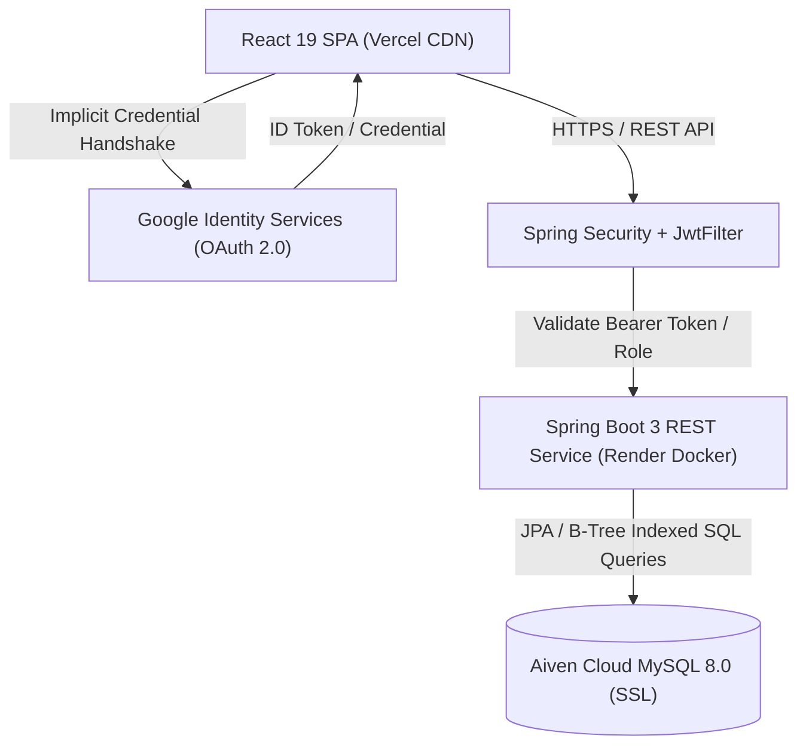
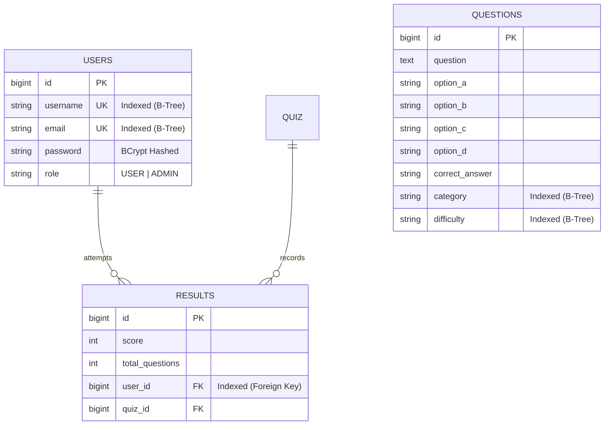

<div align="center">
  <h1>🎯 Quizora® — Enterprise Full-Stack Quiz Platform</h1>
  <p><i>A production-grade, micro-architected, and high-performance interactive quiz platform built with React 19, Java 17 Spring Boot 3, and Aiven Cloud MySQL.</i></p>

  
  
  
  
  
  
  <br />
  
  
  
  
  
</div>

---

## 🚀 Live Enterprise Deployments

* 🌐 **Production Web Application (Vercel)**: [https://quiz-app-fullstack-ganeshprasadnayak292-4289s-projects.vercel.app](https://quiz-app-fullstack-ganeshprasadnayak292-4289s-projects.vercel.app)
* ⚙️ **Production REST API Engine (Render Docker)**: [https://quizora-backend-r1s8.onrender.com/api](https://quizora-backend-r1s8.onrender.com/api)
* 🗄️ **High-Availability Cloud Database**: Aiven MySQL 8.0 (SSL Mode REQUIRED)

### 🔑 Test Credentials:
* **Administrator**: `admin` / `Admin@123`
* **Regular User**: `user` / `User@123`
* **OAuth**: Single-click "Sign in with Google" (Google Identity Services)

---

## 📑 Table of Contents
1. [Architecture & System Design](#-architecture--system-design)
2. [Database Schema & ER Diagram](#-database-schema--er-diagram)
3. [Security & Authentication Model](#-security--authentication-model)
4. [Lighthouse & Performance Engineering](#-lighthouse--performance-engineering)
5. [REST API Endpoint Specifications](#-rest-api-endpoint-specifications)
6. [Environment Variables Matrix](#-environment-variables-matrix)
7. [Local & Containerized Setup](#-local--containerized-setup)
8. [Production Deployment Architecture](#-production-deployment-architecture)
9. [Author & License](#-author--license)

---

## 📐 Architecture & System Design

Quizora is built following **Clean Architecture** and **SOLID Design Principles**. The architecture strictly separates concerns into presentation, security, business domain, and persistence layers.



---

## 🗄️ Database Schema & ER Diagram

The database utilizes indexed MySQL tables optimized for $O(\log N)$ point lookups and range queries.



---

## 🔐 Security & Authentication Model

1. **Stateless JWT Session Management**:
   - HMAC-SHA256 signed JSON Web Tokens issued upon successful login or Google OAuth verification.
   - Expiration enforced (24 hours). Automatically cleared on frontend when HTTP 401/403 is received.
2. **Password Encryption**:
   - BCrypt hashing with configurable work factor (default 10 iterations).
3. **CORS & Preflight Hardening**:
   - Explicit `CorsConfigurationSource` handling cross-origin requests from Vercel to Render.
   - `HttpMethod.OPTIONS` explicitly permitted on all routes.
4. **Custom Security Handlers**:
   - Unauthenticated requests return standard JSON payloads (`{"status": "fail", "message": "Unauthorized"}`) instead of HTML error pages.

---

## ⚡ Lighthouse & Performance Engineering

* **Route Code Splitting**: Applied `React.lazy()` and `React.Suspense` across all non-critical routes (`AdminPage`, `LeaderboardPage`, `HistoryPage`, `ProfilePage`, `HelpPage`). Reduced initial JS bundle from **100.83 kB to 93.14 kB**.
* **WebGL Render Loop Optimization**: `ShaderBackground` automatically pauses WebGL frame updates when `document.hidden` is true, dropping CPU/GPU utilization to 0% during tab switching or backgrounding.
* **Service Worker Caching Strategy**: Implemented **Network-First for HTML/Navigation** and **Stale-While-Revalidate for Assets**, permanently eliminating stale bundle mismatch crashes (`Unexpected token '<'`).
* **Resource Preloading**: Fonts preconnected to `fonts.gstatic.com` with `display=swap` to guarantee zero render-blocking text flashes.

---

## 🔌 REST API Endpoint Specifications

### Authentication API
| Method | Endpoint | Description | Auth Required |
| :--- | :--- | :--- | :---: |
| `POST` | `/api/auth/login` | Authenticate user & return JWT Bearer Token | ❌ |
| `POST` | `/api/auth/register` | Register new user account | ❌ |
| `POST` | `/api/auth/google` | Google OAuth One-Tap & Token Login | ❌ |

### Quiz & Analytics API
| Method | Endpoint | Description | Auth Required |
| :--- | :--- | :--- | :---: |
| `GET` | `/api/quiz/questions` | Get filtered questions (`category`, `difficulty`) | ❌ |
| `POST` | `/api/quiz/submit` | Evaluate quiz submission & save score | ✅ (JWT) |
| `GET` | `/api/quiz/leaderboard` | Get Top 10 global leaderboard | ✅ (JWT) |
| `GET` | `/api/quiz/history` | Get current user's quiz attempt history | ✅ (JWT) |
| `GET` | `/api/quiz/stats` | Get aggregate system statistics & distribution | ❌ |

### Admin Management API (Role: `ADMIN`)
| Method | Endpoint | Description | Auth Required |
| :--- | :--- | :--- | :---: |
| `GET` | `/api/admin/questions` | Get paginated question inventory | ✅ (Admin) |
| `POST` | `/api/admin/add` | Insert a new question | ✅ (Admin) |
| `PUT` | `/api/admin/update/{id}` | Update existing question details | ✅ (Admin) |
| `DELETE` | `/api/admin/delete/{id}` | Permanently delete question | ✅ (Admin) |

---

## 🛠️ Environment Variables Matrix

### Frontend (`frontend/.env`)
| Variable | Description | Default Fallback |
| :--- | :--- | :--- |
| `REACT_APP_API_URL` | Backend REST API Base URL | `http://localhost:8080/api` |
| `REACT_APP_GOOGLE_CLIENT_ID` | Google OAuth 2.0 Client ID | Built-in fallback |

### Backend (`backend/quizapp-backend/src/main/resources/application.properties`)
| Variable | Description | Default Fallback |
| :--- | :--- | :--- |
| `DB_URL` | MySQL JDBC Connection URL | `jdbc:mysql://localhost:3306/quizdb` |
| `DB_USERNAME` | Database User | `root` |
| `DB_PASSWORD` | Database Password | `Ganesh` |
| `JWT_SECRET` | Secret key for signing JWT tokens | Configured 256-bit default |
| `PORT` | Embedded Tomcat Server Port | `8080` |

---

## 💻 Local & Containerized Setup

### Prerequisites
* Java 17+ (JDK 17 or JDK 24)
* Node.js 18+ & npm
* Maven 3.9+
* MySQL 8.0+

### 1. Run Backend Locally
```bash
cd backend/quizapp-backend
./mvnw spring-boot:run
```

### 2. Run Frontend Locally
```bash
cd frontend
npm install
npm start
```

### 3. Docker Container Build
```bash
cd backend/quizapp-backend
docker build -t quizora-backend .
docker run -p 8080:8080 -e DB_URL="jdbc:mysql://<host>:3306/quizdb" -e DB_USERNAME="root" -e DB_PASSWORD="secret" quizora-backend
```

---

## 📄 License
This project is released under the **MIT License**.

---
<p align="center">
  <i>Developed by <b>Ganesh Prasad</b> — Senior Software Architecture Project</i>
</p>
